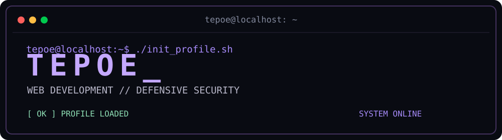
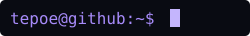

<div align="center">



`WEB DEVELOPER` · `DEFENSIVE SECURITY` · `FRANCE`

*Building for the web. Learning to defend it.*

</div>

---

### `tepoe@localhost:~$ whoami`

```text
Name       : Tepoe
Role       : Web Developer
Focus      : Blue Team / SOC (learning)
Location   : France
Status     : Always learning
```

### `tepoe@localhost:~$ black bat stack.txt`

```text
[ DEVELOPMENT ]
HTML / CSS / JavaScript / React / PHP / WordPress

[ TOOLS ]
Git / Docker / Linux / VS Code

[ SECURITY LAB ]
pfSense / Networking / Defensive Security
```

### `tepoe@localhost:~$ tree projects/`

```text
projects/
├── MIETTES/                 [WEB / WORDPRESS]
└── pfsense-firewall-lab/    [NETWORK SECURITY]
```

- **[MIETTES](https://github.com/Tepoesan/MIETTES)** — Creative WordPress project, custom animations and Docker.
- **[pfSense Firewall Lab](https://github.com/Tepoesan/pfsense-firewall-lab)** — Hands-on network security lab.

### `tepoe@localhost:~$ cat current_focus.txt`

```text
[01] Build practical Blue Team / SOC projects
[02] Explore log analysis and security monitoring
[03] Improve Linux and networking skills
```

---

<div align="center">

`[ SYSTEM STATUS: ALWAYS LEARNING ]`



<sub>Thanks for visiting.</sub>

</div>
