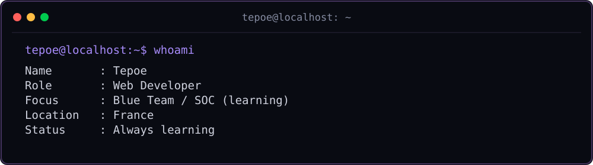
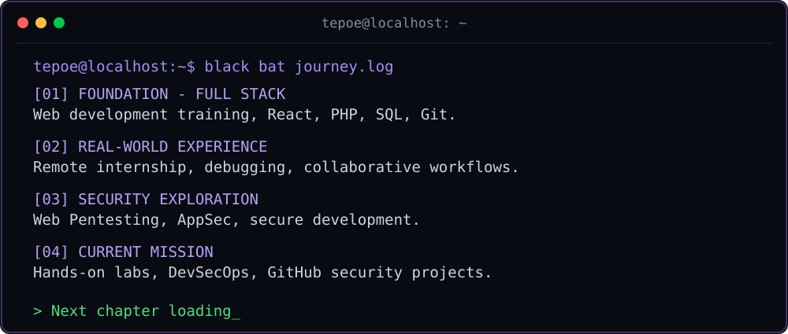
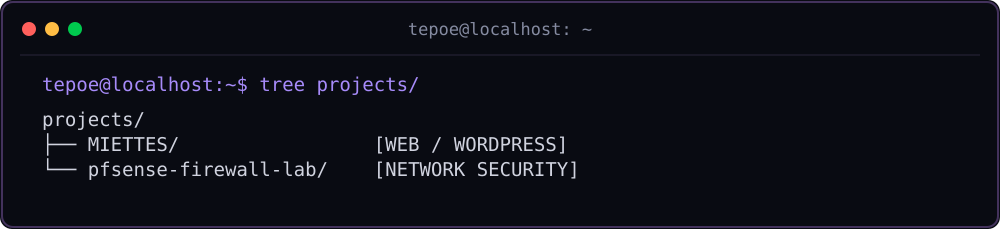
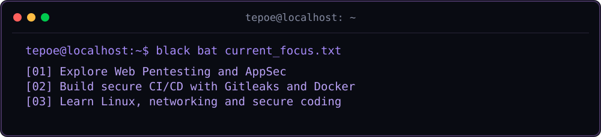

`FULL STACK DEVELOPMENT` · `APPSEC / OFFENSIVE SECURITY` · `FRANCE`

*Building. Breaking ethically. Securing.*

---

- **[MIETTES](https://github.com/Tepoesan/MIETTES)** — WordPress / Docker project with custom development and Gitleaks security checks.
- **[pfSense Firewall Lab](https://github.com/Tepoesan/pfsense-firewall-lab)** — Hands-on network security lab.

---

`[ SYSTEM STATUS: ALWAYS LEARNING ]`

Thanks for visiting.

