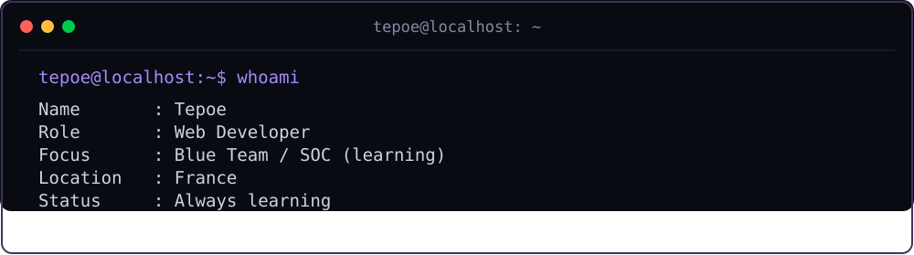
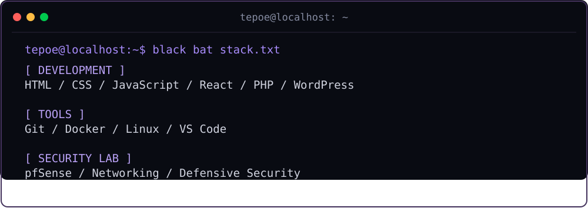
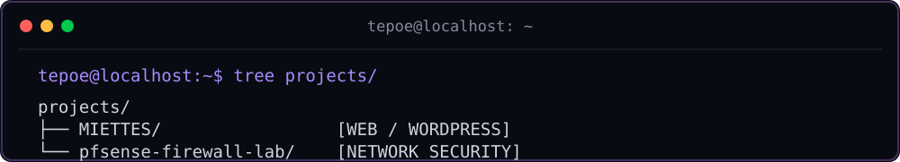
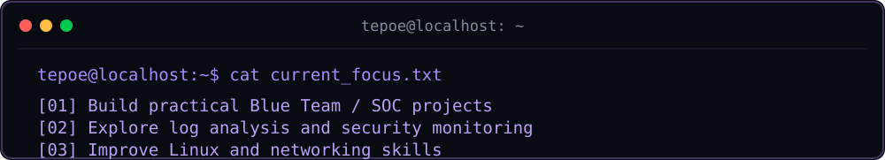

`WEB DEVELOPER` · `DEFENSIVE SECURITY` · `FRANCE`

*Building for the web. Learning to defend it.*

---

- **[MIETTES](https://github.com/Tepoesan/MIETTES)** — Creative WordPress project, custom animations and Docker.
- **[pfSense Firewall Lab](https://github.com/Tepoesan/pfsense-firewall-lab)** — Hands-on network security lab.

---

`[ SYSTEM STATUS: ALWAYS LEARNING ]`

Thanks for visiting.

